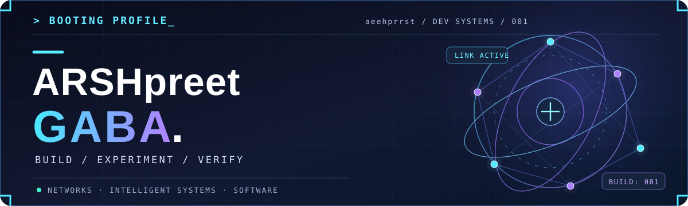

<div align="center">
  

  <a href="https://github.com/aeehprrst">
    
  </a>

  [](https://github.com/aeehprrst)
  [](https://aeehprrst.github.io/chronoroute/)
  [](https://github.com/aeehprrst?tab=repositories)
</div>

---

<!-- FUTURISTIC ANIMATED DEVELOPER TERMINAL -->

<h2 align="center">⌘ SYSTEM TERMINAL // ONLINE</h2>

<div align="center">


</div>

<br/>

<!-- END DEVELOPER TERMINAL -->
## `00 // FUTURISTIC DASHBOARD`

<div align="center">


</div>

<br/>

<div align="center">


</div>

<br/>

---

## `01 // ABOUT THE DEVELOPER`

I'm **Arshpreet Gaba**, a Computer Science student at **VIT Vellore**. I enjoy exploring how complex systems behave — from **satellite network routing** and **power-grid failure analysis** to **modern web applications**.

I care about more than making a demo look impressive: I like to understand the problem, build a working system, test the results, and document how it works.

```text
$ whoami
  Arshpreet Gaba          // @aeehprrst

$ focus --now
  > Computer Networks & Simulation
  > Intelligent Systems & Data-Driven Applications
  > Full-Stack Web Engineering

$ methodology
  BUILD -> TEST -> EXPLAIN -> IMPROVE
```

## `02 // TECH STACK`

<div align="center">

**Languages**


**Frameworks & Tools**


</div>

## `03 // FEATURED BUILDS`

### 🛰️ [ChronoRoute — Routing Beyond the Horizon](https://github.com/aeehprrst/chronoroute)

**LEO satellite networking | Python · C++ · ns-3 · IPv6 · TypeScript**

A research-oriented project exploring **deadline-aware source routing** for low-Earth-orbit satellite constellations. Includes a custom IPv6 routing header, a Python reference simulator, ns-3 implementation, experiments, validation tests, and an interactive satellite-routing website built on public orbital data.

**[🌐 Explore the interactive lab](https://aeehprrst.github.io/chronoroute/)** · **[📁 Source & documentation](https://github.com/aeehprrst/chronoroute)** · **[🧪 Experiments](https://github.com/aeehprrst/chronoroute/tree/main/experiments)**

### ⚡ [GridSense — Understanding Grid Failures](https://github.com/aeehprrst/GridSense)

**Power-grid intelligence | Python · FastAPI · React**

A hackathon project exploring **cascading power-grid failures**, root-cause analysis, simulations of preventive interventions, and equipment predictive maintenance.

**[📁 Explore the project](https://github.com/aeehprrst/GridSense)** · **[📖 Project overview](https://github.com/aeehprrst/GridSense/blob/main/PROJECT-OVERVIEW.md)**

### 🧩 [M.E.R.C. Platform — Web Application](https://github.com/aeehprrst/merc-platform)

**Web engineering | TypeScript · Next.js**

A TypeScript/Next.js web platform, part of my work building and deploying modern web applications.

**[📁 Source code](https://github.com/aeehprrst/merc-platform)** · **[🌐 Live site](https://merc-platform.vercel.app/)**

### 🏥 [MediKiosk — Patient Test-Case Storage](https://github.com/aeehprrst/medikiosk)

**Application development | TypeScript · Next.js**

An application project focused on storing and organizing patient test-case information.

**[📁 Source code](https://github.com/aeehprrst/medikiosk)**

## `04 // ENGINEERING PROOF`

Instead of just listing frameworks, I like showing the work behind a project:

| What to explore | Where to look |
| :-- | :-- |
| **Protocol design** | [ChronoRoute T-CRH specification](https://github.com/aeehprrst/chronoroute/blob/main/spec/tcrh-v1.md) |
| **Reproducible experiments** | [ChronoRoute experiments and results](https://github.com/aeehprrst/chronoroute/tree/main/experiments) |
| **Continuous integration** | [ChronoRoute GitHub Actions](https://github.com/aeehprrst/chronoroute/actions) |
| **Research demo** | [Interactive ChronoRoute website](https://aeehprrst.github.io/chronoroute/) |

## `05 // GITHUB SIGNAL`

<div align="center">
  
  
</div>

## `06 // CONTRIBUTION ENGINE`

<div align="center">
  <picture>
    <source media="(prefers-color-scheme: dark)" srcset="https://raw.githubusercontent.com/aeehprrst/aeehprrst/output/snake-dark.svg" />
    <source media="(prefers-color-scheme: light)" srcset="https://raw.githubusercontent.com/aeehprrst/aeehprrst/output/snake-light.svg" />
    
  </picture>

  <sub>CONTRIBUTION ENGINE ONLINE // AUTOMATICALLY UPDATED DAILY</sub>
</div>

> **Note:** The stats cards use independent third-party services, so they may occasionally fail to load. The contribution snake is generated inside this repository with GitHub Actions.

---

<div align="center">

### `BUILD SOMETHING THAT MATTERS.`

*From an idea to a working prototype. From a prototype to an explainable system.*

**[Explore my repositories →](https://github.com/aeehprrst?tab=repositories)**

<sub>Designed for @aeehprrst · Learn / Build / Test / Share</sub>

</div>
